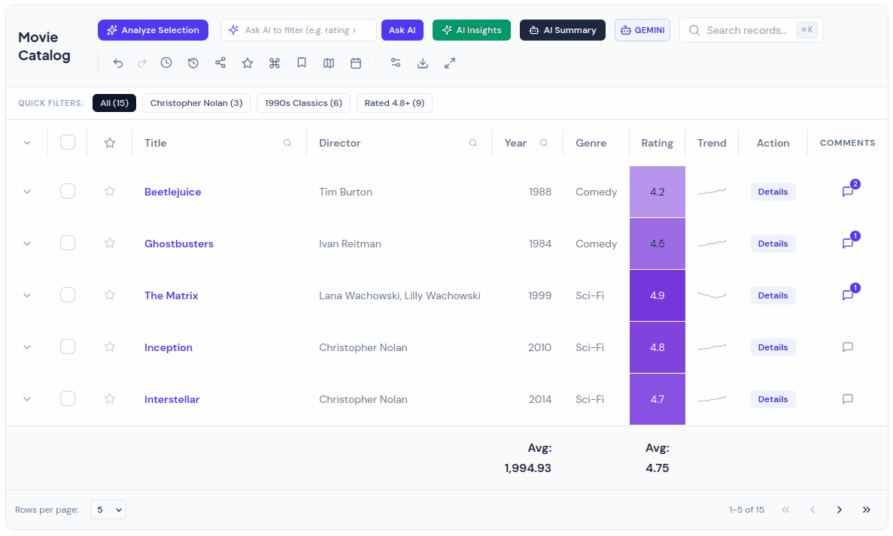

# @enterprisegrid/grid (v3.0.0)

[](./LICENSE)
[](https://github.com/sponsors/enterprisegrid)
[](https://opencollective.com/enterprisegrid)

An enterprise-grade, AI-native, zero-dependency React Data Grid component. Built for maximum developer ergonomics, `@enterprisegrid/grid` **v3.0.0** installs without peer conflicts and works 100% out-of-the-box with **zero external runtime dependencies beyond React** (`react` and `react-dom`). Built-in SVG icons, animation fallbacks, interactive Month/Week/Agenda Calendar views, geospatial Map projections, Sparklines, Heatmaps, and a deterministic local analytical AI engine ensure the grid never breaks even if optional packages are absent.



---

## Table of Contents

1. [Zero-Interruption Installation](#zero-interruption-installation)
2. [Environment Variables & Secret Keys (`.env`)](#environment-variables--secret-keys)
3. [Quick Start](#quick-start)
4. [Enterprise Productivity Features](#enterprise-productivity-features)
5. [Column Auto-Aggregations & Definitions (`TableColumn<T>`)](#column-auto-aggregations--definitions)
6. [Summarizing Data Outside the Table (`<TableSummary />`)](#summarizing-data-outside-the-table)
7. [Universal Multi-LLM Integration (`llmConfig`)](#universal-multi-llm-integration)
8. [Imperative Ref API (`DataTableHandle<T>`)](#imperative-ref-api)
9. [Plugin Architecture (`DataTablePlugin<T>`)](#plugin-architecture)
10. [Exported Hooks & Theming Utilities](#exported-hooks--theming-utilities)
11. [Full Prop Reference](#full-prop-reference)
12. [Funding & Open-Source Sponsorship](#funding--open-source-sponsorship)
13. [License (MIT)](#license)

---

## Zero-Interruption Installation

Install `@enterprisegrid/grid` in any React 18+ or 19+ project:

```bash
npm install @enterprisegrid/grid
```

Import the stylesheet once in your application entry (`main.tsx` or `App.tsx`):

```typescript
import '@enterprisegrid/grid/dist/enterprisegrid.css';
```

### Fault-Tolerant Architecture

- **Zero Mandatory Runtime Dependencies**: Built-in inline SVG icons (`./icons`), reduced-motion-safe animation wrapper (`./motionFallback`), zero-dependency Calendar & Map views (`./NativeViews`), and native SVG sparklines (`./Sparkline`).
- **Offline & Missing-Key Resilience**: AI Query, KPI Insights, and Executive Summaries work out-of-the-box via a built-in deterministic local engine whenever `fallbackToLocal: true` (default) or when `provider: 'local'` is used.

---

## Environment Variables & Secret Keys

All secret keys, API tokens, model IDs, and runtime settings are loaded from environment variables (`.env`) so sensitive credentials are never hardcoded in source files. `@enterprisegrid/grid` exports `readEnvVar` and automatically resolves keys across Node.js (`process.env`), Vite (`import.meta.env.VITE_*`), Next.js (`process.env.NEXT_PUBLIC_*`), and Create React App (`process.env.REACT_APP_*`).

```env
# Server & Runtime Environment Variables
PORT=3000
NODE_ENV=development
DB_FILE_PATH=db.json

# API Security & Rate Limiting
API_RATE_LIMIT_MAX=240
AI_RATE_LIMIT_MAX=30
RATE_LIMIT_WINDOW_MS=60000

# Server-Side LLM & AI Provider Secret Keys
GEMINI_API_KEY=your_gemini_api_key
GEMINI_MODEL=gemini-3.8-flash
OPENAI_API_KEY=your_openai_api_key
OPENAI_BASE_URL=https://api.openai.com/v1/chat/completions
ANTHROPIC_API_KEY=your_anthropic_api_key
ANTHROPIC_BASE_URL=https://api.anthropic.com/v1/messages
OPENROUTER_API_KEY=your_openrouter_api_key
OPENROUTER_BASE_URL=https://openrouter.ai/api/v1/chat/completions
OLLAMA_BASE_URL=http://localhost:11434/v1/chat/completions
CUSTOM_LLM_API_KEY=your_custom_llm_key
CUSTOM_LLM_ENDPOINT=https://your-llm-gateway.example.com/v1/chat

# Client / @enterprisegrid/grid Package Environment Variables
VITE_GA_MEASUREMENT_ID=
VITE_ENTERPRISEGRID_LLM_PROVIDER=gemini
VITE_ENTERPRISEGRID_LLM_MODEL=gemini-3.8-flash
VITE_ENTERPRISEGRID_LLM_ENDPOINT=/api/llm
VITE_ENTERPRISEGRID_LLM_API_KEY=
```

---

## Quick Start

```tsx
import React, { useState } from 'react';
import { DataTable, TableColumn } from '@enterprisegrid/grid';
import '@enterprisegrid/grid/dist/enterprisegrid.css';

interface Product {
  id: number;
  name: string;
  category: string;
  price: number;
  stock: number;
}

const columns: TableColumn<Product>[] = [
  {
    id: 'name',
    name: 'Product Name',
    selector: (row) => row.name,
    sortable: true,
    editable: true,
    pinned: 'left',
    aggregation: 'count',
    aggregationLabel: 'Items',
  },
  {
    id: 'category',
    name: 'Category',
    selector: (row) => row.category,
    sortable: true,
    filterable: true,
  },
  {
    id: 'price',
    name: 'Price ($)',
    selector: (row) => row.price,
    sortable: true,
    filterType: 'number',
    right: true,
    heatmap: true,
    aggregation: 'avg',
    aggregationLabel: 'Avg',
  },
  {
    id: 'stock',
    name: 'Inventory',
    selector: (row) => row.stock,
    sortable: true,
    filterType: 'number',
    right: true,
    aggregation: 'sum',
    aggregationLabel: 'Total',
  },
];

export default function InventoryDashboard({ initialRows }: { initialRows: Product[] }) {
  const [rows, setRows] = useState(initialRows);

  return (
    <DataTable
      id="inventory-grid"
      title="Inventory & AI Intelligence"
      columns={columns}
      data={rows}
      pagination
      searchable
      exportable
      resizable
      selectableRows
      persistStateKey="inventory-grid-v1"
      fullscreenToggle
      enableKeyboardNavigation
      enableContextMenu
      enableAiQuery
      enableAiInsights
      enableAiSummary
      groupBy="category"
      quickFilters={[
        { id: 'low-stock', label: 'Low Stock (<20)', predicate: (r) => r.stock < 20 },
        { id: 'premium', label: 'Premium ($500+)', predicate: (r) => r.price >= 500 },
      ]}
      onAddRow={(draft) => setRows((prev) => [{ id: Date.now(), ...(draft as Product) }, ...prev])}
      onDeleteRows={(selected) => setRows((prev) => prev.filter((r) => !selected.includes(r)))}
      llmConfig={{
        provider: 'gemini',
        model: 'gemini-3.8-flash',
        endpoint: '/api/llm-proxy',
        fallbackToLocal: true,
      }}
    />
  );
}
```

---

## Enterprise Productivity Features

- **Container-Aware Responsive Layout & Mobile Cards (`responsiveLayout`, `mobileBreakpoint`)**: Observes container width via `ResizeObserver` (adapting cleanly inside phones, split panes, and sidebars). Automatically renders stacked mobile cards below `mobileBreakpoint` (`640px` default) in `'auto'` mode with a toolbar `Cards / Table` switcher, slide-over `SidePreview` drawer on small screens, and horizontal scroll on narrow calendar grids.
- **Drag & Double-Click Column Resizing (`resizable`)**: Drag column header handles to adjust widths smoothly or double-click any handle to reset back to auto-fit.
- **Row Numbers, Search Match Highlighting & Live Status Strip (`showRowNumbers`, `highlightSearch`, `showStatusBar`)**: Optional 1-based `#` index column, automatic `<mark>` highlighting of global search matches, and an Excel/AG-Grid style bottom status bar displaying row counts, selection count, and live `Sum / Avg / Min / Max`.
- **Interactive Column Facet Quick-Select**: Column filter popovers automatically list top unique values with occurrence counts for one-click filtering.
- **Quick Filter Chips (`quickFilters`)**: Segmented filter buttons rendered above the grid with live match counts and an automatic `All` reset toggle.
- **Contextual Bulk Action Bar (`bulkActions`, `onDeleteRows`)**: Automatically surfaces when rows are selected, providing one-click `Export Selected`, `Delete (N)`, and custom batch callbacks `(selectedRows, clearSelection) => void`.
- **Built-in Add Row & CSV/TSV Import (`onAddRow`, `onImportRows`)**: Automatically renders `+ Add Row` and `Import CSV` toolbar buttons with typed record entry and file upload/paste preview modals mapped directly to your columns.
- **Windowed Row Virtualization (`virtualize`, `virtualRowHeight`, `virtualOverscan`)**: Renders large unpaginated datasets smoothly at 60fps with zero external dependencies using dynamic top/bottom spacers and `ResizeObserver`.
- **Copyable Cells (`column.copyable`)**: Displays a hover-revealed one-click copy icon with copied confirmation state inside cells.
- **Inline Edit Undo (`Ctrl+Z` / `ref.undoLastEdit()`)**: Maintains an undo history stack for inline cell edits alongside `Reset Layout` in the toolbar settings menu.
- **Right-Click Row Context Menu (`enableContextMenu`, `rowContextMenu`)**: Built-in actions (`Copy Row JSON`, `Inspect in Side Preview`, `Toggle Bookmark`) plus custom `RowContextMenuItem<T>[]` items.
- **Keyboard Cell/Row Navigation (`enableKeyboardNavigation`)**: Navigate cells using `ArrowUp`, `ArrowDown`, `ArrowLeft`, `ArrowRight`; toggle row selection with `Space`; trigger inline cell edit or side preview with `Enter`; clear focus with `Escape`.
- **Fullscreen Mode (`fullscreenToggle`)**: Toolbar toggle + `Escape` exit + Command Palette entry.
- **Persistent Grid State (`persistStateKey`)**: Saves/restores column order, visibility, widths, pinned columns, density, group-by, and rows per page to `localStorage` (`eg_state_${persistStateKey}`).
- **Multi-Format Export + Print**: Export or copy filtered/selected rows to **CSV**, **JSON**, **Markdown Table** (`.md`), **HTML Report** (`.html`), **Copy TSV**, or open **Print View** (`window.print()`).
- **Command Palette (`Ctrl+K` / `Cmd+K`)**: Keyboard-first launcher for switching views, density, columns, fullscreen, CSV import, undo, resetting layout/filters, and exporting.

---

## Column Auto-Aggregations & Definitions

Each `TableColumn<T>` supports built-in footer aggregations that compute dynamically over the active filtered/sorted dataset:

```tsx
const columns: TableColumn<Deal>[] = [
  { id: 'account', name: 'Account', selector: (r) => r.account, aggregation: 'count', aggregationLabel: 'Deals' },
  { id: 'region', name: 'Region', selector: (r) => r.region, aggregation: 'unique', aggregationLabel: 'Regions' },
  { id: 'arr', name: 'ARR ($)', selector: (r) => r.arr, right: true, aggregation: 'sum', aggregationLabel: 'Total' },
  { id: 'seats', name: 'Seats', selector: (r) => r.seats, right: true, aggregation: 'avg', aggregationLabel: 'Avg' },
  {
    id: 'margin',
    name: 'Margin',
    selector: (r) => r.margin,
    right: true,
    aggregation: (rows) => `${(rows.reduce((a, r) => a + r.margin, 0) / Math.max(rows.length, 1)).toFixed(1)}%`,
  },
];
```

Supported `aggregation` modes: `'sum' | 'avg' | 'min' | 'max' | 'count' | 'unique' | ((rows: T[]) => React.ReactNode)`.

Key `TableColumn<T>` options:
- **Core**: `id`, `name`, `selector`, `cell`, `format`
- **Sorting & Filtering**: `sortable`, `sortFunction`, `sortField`, `filterable`, `filterType` (`'text' | 'number' | 'date'`), `filterFunction`
- **Editing**: `editable`, `editor` (`text | number | date | checkbox | select | custom`), `validate`
- **Layout & Visuals**: `width`, `minWidth`, `maxWidth`, `grow`, `right`, `center`, `wrap`, `compact`, `button`, `copyable`, `allowOverflow`, `ignoreRowClick`, `hide` (`'sm' | 'md' | 'lg' | number`), `omit`, `reorder`, `pinned` (`'left' | 'right' | null`), `sparkline`, `sparklineConfig`, `heatmap`, `heatmapConfig`, `conditionalCellStyles`, `footer`, `aggregation`, `aggregationLabel`

---

## Summarizing Data Outside the Table

Place `<TableSummary />` anywhere in your UI (top executive bar, sidebar, below the grid, or in another card) and bind it with `onSummaryChange`, or let `<DataTable externalSummary="top" | "bottom" | "both" />` render it automatically.

```tsx
import React, { useState } from 'react';
import { DataTable, TableSummary, ExternalSummaryData } from '@enterprisegrid/grid';

export function ExecutiveReport({ columns, data }) {
  const [summaryData, setSummaryData] = useState<ExternalSummaryData | null>(null);

  return (
    <div className="space-y-6">
      <TableSummary
        summaryData={summaryData}
        title="Executive Dataset Summary"
        variant="detailed" // 'detailed' | 'cards' | 'compact' | 'sidebar'
        llmConfig={{ provider: 'gemini', model: 'gemini-3.8-flash', fallbackToLocal: true }}
      />

      <DataTable
        columns={columns}
        data={data}
        selectableRows
        searchable
        onSummaryChange={setSummaryData}
      />
    </div>
  );
}
```

You can also compute summaries imperatively with `computeExternalSummary(rows, columns, options)` or via `tableRef.current?.getSummaryData()`.

---

## Universal Multi-LLM Integration

Connect any LLM provider via `llmConfig`:

| Provider | Example `model` | Notes |
| --- | --- | --- |
| `'gemini'` | `'gemini-3.8-flash'` | Recommended for Google Gemini REST or backend proxy |
| `'openai'` | `'gpt-4o-mini'` | Supports OpenAI-compatible endpoints & custom `baseUrl` |
| `'anthropic'` | `'claude-3-5-sonnet-latest'` | Supports Anthropic `/v1/messages` or proxy |
| `'ollama'` | `'llama3.2'` | Connects directly to local `http://localhost:11434/api/chat` |
| `'openrouter'` | `'openai/gpt-4o-mini'` | Supports OpenRouter unified gateway |
| `'custom'` | any | Provide `endpoint` or custom `complete(prompt, context)` async function |
| `'local'` | — | Pure client-side analytical engine with zero network calls |

### Custom `complete()` Callback Example

```tsx
<DataTable
  columns={columns}
  data={data}
  enableAiQuery
  enableAiInsights
  enableAiSummary
  llmConfig={{
    provider: 'custom',
    fallbackToLocal: true,
    complete: async (prompt, context) => {
      const res = await myCustomLlmClient.chat({
        messages: [
          { role: 'system', content: context.systemPrompt },
          { role: 'user', content: prompt },
        ],
      });
      return res.text;
    },
  }}
/>
```

---

## Imperative Ref API

Attach a React `ref` typed with `DataTableHandle<T>`:

```tsx
const tableRef = useRef<DataTableHandle<MyRow>>(null);
```

| Method | Signature | Description |
| --- | --- | --- |
| `clearSort` | `() => void` | Resets sort state back to `defaultSortFieldId` or clears sorting. |
| `clearSelectedRows` | `() => void` | Deselects all currently selected rows. |
| `selectAll` | `() => void` | Selects all non-disabled rows in the active filtered dataset. |
| `expandAllRows` | `() => void` | Expands all non-disabled expandable rows in the active filtered dataset. |
| `collapseAllRows` | `() => void` | Collapses all expanded rows. |
| `resetFilters` | `() => void` | Clears global search, column filters, quick filters, AI filter, bookmarks filter, and grouping. |
| `resetLayout` | `() => void` | Restores column order, visibility, widths, pinning, density, grouping, and clears `persistStateKey` storage. |
| `setSearch` | `(query: string) => void` | Programmatically updates the global search input. |
| `setGroupBy` | `(columnId: string \| null) => void` | Programmatically sets or clears row grouping by column ID. |
| `exportCSV` | `() => void` | Triggers a CSV download of the active filtered view. |
| `exportJSON` | `() => void` | Triggers a JSON download of the active filtered view. |
| `exportMarkdown` | `() => void` | Triggers a Markdown `.md` download of the active filtered view. |
| `exportHTML` | `() => void` | Triggers a standalone styled `.html` report download of the active filtered view. |
| `copyAsMarkdown` | `() => Promise<boolean>` | Copies the active filtered view to the clipboard formatted as a Markdown table. |
| `undoLastEdit` | `() => boolean` | Reverts the most recent inline cell edit via `onCellEdit` and returns `true` if undone. |
| `importCSV` | `(csvText: string) => Partial<T>[]` | Parses CSV/TSV text, maps headers to columns, invokes `onImportRows`, and returns mapped rows. |
| `scrollToRow` | `(index: number) => void` | Smoothly scrolls the table body container to the specified row index. |
| `goToPage` | `(page: number) => void` | Programmatically navigates to the specified 1-based page number. |
| `getSelectedRows` | `() => T[]` | Returns the array of currently selected row objects. |
| `getFilteredData` | `() => T[]` | Returns the currently filtered and sorted rows. |
| `getSummaryData` | `() => ExternalSummaryData<T>` | Computes live KPI and column aggregation metrics on demand. |
| `toggleFullscreen` | `() => void` | Toggles fullscreen mode on the grid wrapper. |

---

## Plugin Architecture

Extend the grid declaratively via `plugins: DataTablePlugin<T>[]`:

```tsx
const auditBadgePlugin: DataTablePlugin<MyRow> = {
  name: 'audit-badge',
  onInit: ({ setDensity }) => setDensity('compact'),
  renderToolbarRight: () => <button>Sync ERP</button>,
  renderRowAction: (row) => <button onClick={() => inspect(row)}>Inspect</button>,
  transformData: (rows) => rows.filter((r) => !r.archived),
  transformColumns: (cols) => cols,
};
```

---

## Exported Hooks & Theming Utilities

- `createTheme(name, overrides, inherit?)` — Register a custom theme in the global theme registry and activate it via `theme={name}`.
- `useColumnVisibility(columns)` — Standalone hook returning `{ columns, visibility, toggle, setAll }`.
- `useTableExport({ columns, rows, valueSource, headerOverrides, columnOrder })` — Headless export hook returning `{ toCSV, toJSON, download, copy }`.
- `parseCSV(csvText)` — Zero-dependency RFC-4180 CSV/TSV parser supporting quoted fields, escaped quotes, and auto delimiter detection.
- `computeExternalSummary(rows, columns, options)` — Pure helper returning `ExternalSummaryData<T>`.
- `executeLLMTask(config, request, columns)` — Direct adapter helper for programmatic LLM execution.

---

## Full Prop Reference

- **Core**: `id`, `columns`, `data`, `keyField`, `config`, `plugins`, `disabled`
- **Header & Appearance**: `title`, `actions`, `subHeader`, `subHeaderAlign`, `subHeaderWrap`, `noHeader`, `noTableHead`, `persistTableHead`, `dense`, `responsive`, `responsiveLayout`, `mobileBreakpoint`, `showRowNumbers`, `highlightSearch`, `showStatusBar`, `fixedHeader`, `fixedHeaderScrollHeight`, `direction`, `className`, `style`, `ariaLabel`, `theme`, `customStyles`, `striped`, `highlightOnHover`, `pointerOnHover`, `columnSeparator`, `headerSeparator`, `animateRows`, `conditionalRowStyles`
- **Enterprise Productivity & Performance**: `virtualize`, `virtualRowHeight`, `virtualOverscan`, `onImportRows`, `quickFilters`, `bulkActions`, `onDeleteRows`, `onAddRow`, `addRowLabel`, `enableContextMenu`, `rowContextMenu`, `enableKeyboardNavigation`, `fullscreenToggle`, `persistStateKey`, `groupBy`, `resizable`, `columnGroups`, `onCellEdit`, `onColumnOrderChange`, `onColumnGroupOrderChange`, `mobileSwipeActions`, `renderSidePreview`
- **AI & External Summary**: `llmConfig`, `enableAiQuery`, `onAiQuery`, `enableAiInsights`, `onAiInsights`, `enableAiSummary`, `onAiSummary`, `externalSummary`, `externalSummaryTitle`, `externalSummaryVariant`, `onSummaryChange`
- **Sorting & Filtering**: `sortable`, `defaultSortFieldId`, `defaultSortAsc`, `sortServer`, `sortMulti`, `sortFunction`, `sortIcon`, `onSort`, `filterValues`, `onFilterChange`
- **Pagination & Footer**: `pagination`, `paginationPerPage`, `paginationPosition`, `paginationRowsPerPageOptions`, `paginationDefaultPage`, `paginationPage`, `paginationResetDefaultPage`, `paginationTotalRows`, `paginationServer`, `paginationServerOptions`, `paginationComponentOptions`, `paginationComponent`, `paginationIcons`, `onChangePage`, `onChangeRowsPerPage`, `showFooter`, `footerComponent`
- **Selection & Expansion**: `selectableRows`, `selectableRowsSingle`, `selectableRowsNoSelectAll`, `selectableRowsVisibleOnly`, `selectableRowsHighlight`, `selectableRowsRange`, `selectableRowDisabled`, `selectableRowSelected`, `selectedRows`, `selectableRowsComponent`, `selectableRowsComponentProps`, `onSelectedRowsChange`, `expandableRows`, `expandableRowsComponent`, `expandableRowsComponentProps`, `expandableRowExpanded`, `expandableRowDisabled`, `expandableRowsHideExpander`, `expandOnRowClicked`, `expandOnRowDoubleClicked`, `expandableInheritConditionalStyles`, `expandableIcon`, `onRowExpandToggled`
- **Row & Scroll Events**: `onRowClicked`, `onRowDoubleClicked`, `onRowMiddleClicked`, `onRowMouseEnter`, `onRowMouseLeave`, `onScroll`
- **Multi-View Configs**: `mapConfig`, `calendarConfig`, `kanbanConfig`, `galleryConfig`, `localization`

---

## Package Exports

- **ESM**: `dist/enterprisegrid.mjs`
- **CJS**: `dist/enterprisegrid.cjs`
- **Styles**: `dist/enterprisegrid.css`
- **TypeScript Declarations**: `dist/index.d.ts`

---

## Funding & Open-Source Sponsorship

`@enterprisegrid/grid` is **100% free and open-source** software maintained under the permissive **MIT License**. If EnterpriseGrid powers your production dashboards or saves your engineering team time, consider supporting ongoing development and maintenance:

- **GitHub Sponsors**: [https://github.com/sponsors/enterprisegrid](https://github.com/sponsors/enterprisegrid)
- **Open Collective**: [https://opencollective.com/enterprisegrid](https://opencollective.com/enterprisegrid)
- **Patreon**: [https://patreon.com/enterprisegrid](https://patreon.com/enterprisegrid)
- **CLI Funding Info**: Run `npm fund @enterprisegrid/grid` in your project terminal.

---

## License

Released under the **[MIT License](./LICENSE)**. Free for personal, commercial, and enterprise use.
